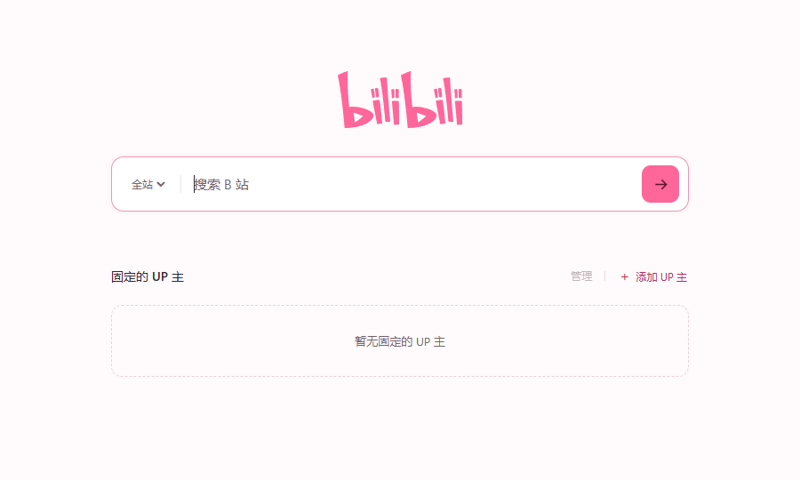

<p align="center"></p>
<h1 align="center">只看</h1>
<p align="center">只看想看的。</p>
<p align="center"><a href="https://greasyfork.org/zh-CN/scripts/600653-%E5%8F%AA%E7%9C%8B">安装脚本</a> · <a href="https://github.com/qwertybuaa/zhikan/releases/latest">下载 Chrome 扩展</a></p>

打开 B 站，首页只留下一个搜索框，和你亲手固定的 UP 主。



- 固定常看的 UP 主，一步直达投稿页。
- 全站搜索，或只搜某位 UP 主。
- 从空白列表开始，随时添加、编辑、移除和撤销。
- 在工具栏菜单中开启或关闭极简首页。

## 安装

### Tampermonkey 脚本

安装 Tampermonkey，打开 [Greasy Fork](https://greasyfork.org/zh-CN/scripts/600653-%E5%8F%AA%E7%9C%8B)，点击「安装此脚本」。新版 Chrome 需在 Tampermonkey 的扩展详情中开启「允许运行用户脚本」。

### Chrome 扩展

1. 从 [Releases](https://github.com/qwertybuaa/zhikan/releases/latest) 下载 ZIP 并解压。
2. 打开 `chrome://extensions`，开启「开发者模式」。
3. 点击「加载已解压的扩展程序」，选择包含 `manifest.json` 的文件夹。
4. 打开 B 站首页。

保留安装文件夹。更新时覆盖原文件，并在扩展管理页点击「重新加载」，即可保留固定列表。下载源码安装时，选择 `extension/` 文件夹。

## 使用

点击「添加 UP 主」填写空间链接或 UID。点击已固定的 UP 主进入投稿页；搜索框左侧可以切换搜索范围。

访问 UP 主空间时，脚本版可在 Tampermonkey 菜单选择「固定当前 UP 主」；扩展版可点击工具栏图标添加。

极简首页开关位于各自的工具栏菜单。两个版本的固定列表分别保存，选择其中一种安装方式使用。

## 开发

扩展由原生 HTML、CSS 和 JavaScript 编写，使用 Manifest V3，可直接加载 `extension/`。用户脚本复用同一套界面和核心逻辑。

需要 Node.js 18+ 和 Python 3：

```sh
npm test
npm run build:userscript
npm run package
```

- `extension/`：Chrome 扩展源码。
- `userscript/runtime.js`：脚本管理器适配与首页挂载逻辑。
- `userscript/zhikan.user.js`：完整可读的用户脚本。
- `scripts/`：用户脚本生成和扩展打包。
- `tests/`：URL 校验、搜索编码和首页范围测试。
- `assets/`：Logo 和界面截图。

数据保存在浏览器扩展或脚本管理器中。点击搜索和投稿时，会正常访问 B 站。

素材来源见 [SOURCES.md](extension/icons/SOURCES.md)。
